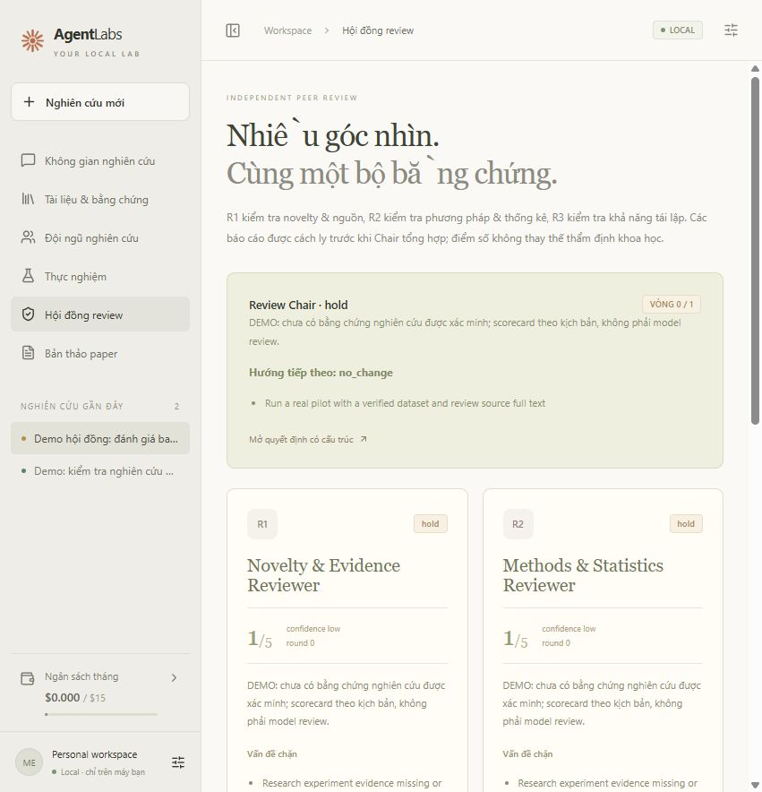

# AgentLabs — local AI/ML research harness

Ứng dụng local có UI chat, 10 vai trò: 6 agent tác vụ, 3 reviewer độc lập và 1 Review Chair, tool calling, checkpoint SQLite, tài liệu có provenance, mã thực nghiệm chờ duyệt, bản nháp và kiểm tra bằng chứng. Mục tiêu ngân sách API: **10–20 USD/tháng**.

Repository: [KhanhGiauTen/AgentLabs](https://github.com/KhanhGiauTen/AgentLabs). Xem [thiết kế agentic system](docs/ARCHITECTURE.md), [milestones dài hạn](docs/ROADMAP.md) và [hướng dẫn đóng góp](CONTRIBUTING.md).



**Project đang đặt tại `D:\ResearchLab\research-studio`.** OpenClaw source: `D:\ResearchLab\openclaw`. Dependency/runtime: `D:\ResearchLab\work`. Thư mục output trong Codex liên kết đến project trên D.

## Mở ngay

Trên máy đã được cài trong phiên làm việc này:

```powershell
cd D:\ResearchLab\research-studio
.\start.ps1
```

Hoặc double-click **Start AgentLabs.cmd**, mở [AgentLabs](http://127.0.0.1:8765). Chọn **Demo** để kiểm tra toàn bộ luồng mà không cần API key. Demo là kịch bản được ghi nhãn; không tạo kết quả nghiên cứu giả.

Nếu PowerShell chặn script:

```powershell
powershell -NoProfile -ExecutionPolicy Bypass -File .\start.ps1
```

Cài lại trên máy khác (Python 3.11+ và Node phù hợp Vite):

```powershell
git clone https://github.com/KhanhGiauTen/AgentLabs.git
cd AgentLabs
.\setup.ps1
.\start.ps1
```

Các tiến trình chạy foreground trong terminal để bạn dừng bằng Ctrl+C. Không cài Windows service hay lịch chạy nền. Nguồn frontend đã build thành `frontend/dist`; backend phục vụ cả UI và API trên cùng port.

## Model thật

Mở `.env` bằng editor local, điền key cần dùng rồi khởi động lại backend. **Không gửi key qua chat.**

| Chế độ | Cách chạy | Điều kiện |
| --- | --- | --- |
| Demo | Nội dung theo kịch bản, không gọi LLM | Không key |
| Lean | Luna cho 8 vai trò, Sol cho Methods và Review Chair | `OPENAI_API_KEY` |
| Hybrid | 8 vai trò dùng model OpenRouter `:free`, 2 vai trò Sol | Thêm `GATEWAY_API_KEY`, `GATEWAY_MODEL` |
| Free | Tất cả qua model `:free` do bạn chọn | Tool-capable free model, quota còn |
| Local | OpenAI-compatible endpoint Ollama trên loopback | Cài/chạy Ollama và model có tool calling |
| OpenClaw | Lượt model đi qua OpenClaw local OpenResponses | Runtime, token gateway, model key; xem hướng dẫn dưới |
| Claude | Sonnet, Opus cho bước quan trọng | `ANTHROPIC_API_KEY`; chi phí cao hơn Lean |

**Khuyến nghị khởi đầu: Lean, giới hạn tháng $15, mỗi workflow $0.75 (tăng lên $1–2 nếu cho phép vòng sửa).** Dùng Hybrid khi đã chọn được model free gọi tool ổn. OpenClaw có overhead riêng: đặt giới hạn lượt khoảng $2 dự phòng và theo dõi usage của provider. Giới hạn ở ứng dụng dựa trên ước tính, không thay thế spending limit của nhà cung cấp.

## Dùng OpenClaw đã clone

```powershell
.\scripts\openclaw.ps1 -Action version
.\scripts\openclaw.ps1 -Action validate
.\scripts\openclaw.ps1 -Action start
```

Trong terminal khác chạy `start.ps1`, sau đó chọn chế độ **OpenClaw** trên UI. Gateway ở `127.0.0.1:18789`; app ở `127.0.0.1:8765`.

Source được clone shallow nhưng có toàn bộ working tree, pin **v2026.10.7**, commit `157d8c2bc3ea2fa183afdc11088e69690bf8e64e`. Runtime đang dùng package chính thức `openclaw@2026.10.7`, cùng commit, có sẵn bản build; chưa compile toàn bộ monorepo upstream. Harness là source Python/React độc lập, sửa được ngay. Chi tiết và cách tự build upstream ở [OPENCLAW.md](docs/OPENCLAW.md).

Các upstream được pin tại `upstreams.lock.json`; clone lại đúng commit bằng `scripts/clone-references.ps1`. Script giữ nguyên checkout đã tồn tại nếu commit không khớp và báo cần kiểm tra, không reset công việc local.

## Quy trình

1. Nhập câu hỏi, notes, giới hạn lượt; có thể đính kèm PDF/text và CSV/JSON trước khi chạy.
2. PI xác định phạm vi → Literature tìm nguồn → Methods thiết kế protocol → Engineer stage `experiment.py`.
3. Tại điểm duyệt, đọc protocol và mã. Chọn chạy Docker hoặc bỏ qua.
4. Analyst đọc metrics/log → Writer viết draft → R1/R2/R3 review độc lập → Review Chair tổng hợp → audit và điều hướng có giới hạn.
5. Bạn đọc manuscript, nguồn và review rồi xác nhận nhận bản nháp. Export ZIP gồm artifacts và log. Ứng dụng không nộp paper.

Mỗi lần gửi là một workflow mới. Khi bật “Kèm bản nháp và nguồn của lượt hiện tại”, workflow mới kế thừa các bản nháp, source registry, tài liệu và dataset để bạn lặp lại nghiên cứu. Các agent tác vụ theo thứ tự; ba reviewer fan-out độc lập rồi join ở Chair. Chair có thể route sửa manuscript tối đa một vòng, hoặc đề xuất quay lại Literature/Methods qua human gate. Không tự tìm kiếm hàng chục giả thuyết hay tự sửa code vô hạn.

## Thực nghiệm thật

Docker CLI có trên máy, nhưng Docker engine chưa chạy trong lần thiết lập. Cần mở Docker Desktop và bảo đảm Docker lưu disk image trên D nếu muốn toàn bộ workload ở D. Sau đó:

```powershell
cd D:\ResearchLab\research-studio
docker build -t research-studio-sandbox:local .\sandbox
```

Chỉ sau khi build thành công mới chọn **Duyệt & chạy Docker**. Image không tự pull khi chạy. Container: không network, root filesystem read-only, bỏ capabilities, user không phải root, 2 CPU, 1 GB RAM, timeout 120 giây. Chỉ script được duyệt và dataset đã import được mount; `.env` và source ứng dụng không mount vào container. Dataset có path `/inputs/input-<hash>.csv` hoặc `.json`, read-only.

Đây là worker CPU cho thử nghiệm nhỏ. Chưa có GPU, SSH, cluster, tracking MLflow hoặc training LLM dài. Bỏ qua thực nghiệm sẽ ghi `skipped`; bản thảo không được có Results giả. Demo chỉ tạo synthetic smoke test, không triển khai ý tưởng nghiên cứu bạn nhập.

## Tài liệu và bằng chứng

- Crossref trả metadata/DOI; arXiv trả abstract/ID. Không gọi việc tìm metadata là đã đọc full text.
- Import PDF/text tối đa 10 MB/file; tối đa 50 trang, 250k ký tự text được trích, không OCR. Chunk có document hash, số trang và ID. Tìm kiếm chunk là lexical, chưa phải vector RAG.
- CSV/JSON tối đa 10 MB/file, tối đa 5 dataset/lượt. Không tải dataset ngoài tự động trong sandbox offline.
- `quality-gates.json` kiểm tra DOI có trong registry, draft marker, sự tồn tại của evidence. **Không chứng minh citation hỗ trợ claim, novelty, thống kê hay tính đúng khoa học.**
- Dữ liệu ở trên máy; khi chọn API/cloud, prompt, snippets, dataset preview và tool results cần thiết được gửi tới provider bạn chọn. Chế độ local còn phụ thuộc endpoint/model bạn tự cấu hình.

## Chi phí, thiết kế và kiểm thử

- [Thiết kế harness và phân công](docs/ARCHITECTURE.md)
- [Đề xuất chi phí $10–20/tháng](docs/COSTS.md)
- [Setup và hợp đồng tích hợp OpenClaw](docs/OPENCLAW.md)
- [Kết quả kiểm thử và phần chưa xác minh](docs/VALIDATION.md)

Dependency trực tiếp được pin; `frontend/package-lock.json` và `requirements-lock.txt` ghi lại môi trường đã cài. `requirements-lock.txt` hiện là snapshot Windows/Python 3.11; dùng `requirements.txt` nếu cài trên nền tảng khác.

```powershell
# Test không gọi API trả phí
D:\ResearchLab\work\.venv\Scripts\python.exe -m pytest tests -q --basetemp D:\ResearchLab\work\pytest-manual-01
```

Nếu thư mục basetemp đã tồn tại và chứa dữ liệu cần giữ, đổi sang tên mới. Frontend build: `cd frontend; npm run build`.

## Dữ liệu vận hành

`data/studio.sqlite` lưu runs, event log, ledger và settings; `data/checkpoints.sqlite` lưu LangGraph checkpoints; `data/runs/<id>/` lưu artifact. OpenClaw có state riêng dưới `D:\ResearchLab\work\openclaw-state`. Đừng xóa hoặc chép SQLite đang có tiến trình ghi; dừng app/gateway trước khi backup. Không commit `.env`, data hay runtime.

Đây là nền tảng local có chức năng thực, chưa phải lab tự động đã được benchmark chất lượng paper. Trước khi dùng cho nghiên cứu nghiêm túc, chạy một pilot nhỏ với key của bạn và dữ liệu có ground truth, kiểm tra từng artifact và đối chiếu hóa đơn provider.
