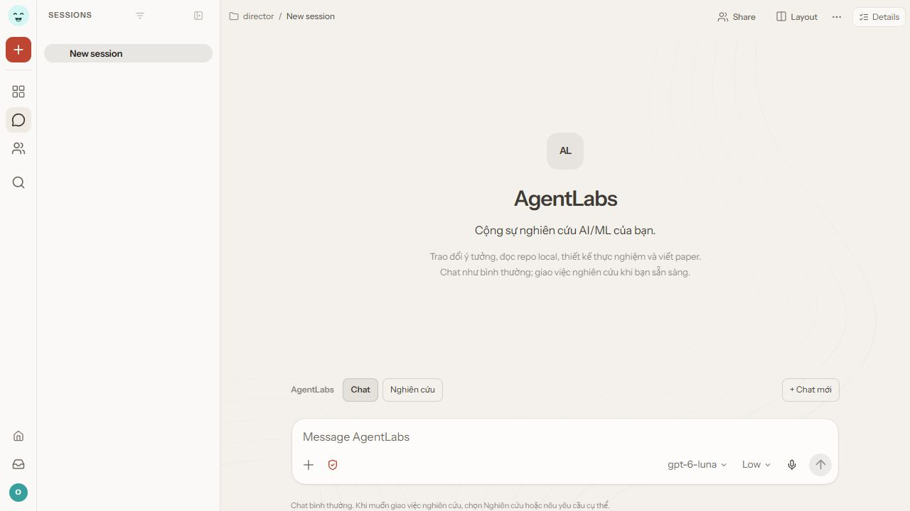

# AgentLabs — local research lab on OpenClaw

AgentLabs customize **OpenClaw native** thành trợ lý AI/ML: chat bình thường,
chỉ gọi đội nghiên cứu khi bạn giao nhiệm vụ rõ ràng. OpenClaw quản lý UI, session
và subagents; plugin AgentLabs quản lý artifacts, ba reviewer độc lập, Chair,
budget và bước duyệt thực nghiệm. AgentLaboratory là nguồn tham khảo scientific lifecycle.

Project local: `D:\ResearchLab\research-studio`. Source upstream, runtime và state
nằm trên D. Bản Python/LangGraph/React cũ giữ tại `start.ps1`, port 8765;
[hướng dẫn prototype V1](docs/PROTOTYPE_V1.md) chỉ áp dụng cho bản đó.

- [Thiết kế V2 và các phòng ban](docs/NATIVE_RESEARCH_DESIGN.md)
- [Kiểm thử và phần chưa xác minh](docs/VALIDATION.md)
- [Third-party notices](THIRD_PARTY_NOTICES.md)



Native source: `D:\ResearchLab\openclaw-native`, pin **v2026.10.10-beta.3**
(`15dffe52`), runtime official riêng tại `work/openclaw-native-runtime`.
Đây là prerelease đã pin để lấy bản sửa canonical-startup checkpoint;
v2026.10.7 đã bị tái hiện lỗi từ chối nhiều agent sau restart trên máy này.
[Upstream issue và provenance của bản sửa](https://github.com/openclaw/openclaw/issues/166634).
Không tự cập nhật beta. State có backup trước migration; downgrade cần phục hồi
backup tương thích, không dùng runtime cũ ghi vào schema mới.

Source v2026.10.7 cũ vẫn ở `D:\ResearchLab\openclaw` phục vụ V1/reference.
AgentLaboratory và OpenClaude cũng đã clone để đọc. OpenClaude chỉ là read-only
reference do LICENSE NOTICE về code proprietary; không đưa source đó vào sản phẩm.
Xem `upstreams.lock.json` và lockfile runtime trong `native/runtime/`.

Cài mới trên Windows (Python 3.11+, Node >=24.22.1 <25 hoặc >=26.12.1):

```powershell
git clone https://github.com/KhanhGiauTen/AgentLabs.git
cd AgentLabs
.\setup-native.ps1
```

## Quick start (Windows / local only)

```powershell
cd D:\ResearchLab\research-studio
# Fresh install only: .\setup-native.ps1
.\agentlabs.ps1 start
# Another terminal; opens the authenticated native UI without printing tokens:
.\agentlabs.ps1 dashboard
```

Default UI: `http://127.0.0.1:18790`. Model proxy: loopback port 18791.
Ctrl+C in the start terminal stops its owned processes. `openclaw` on PATH may
select another installation/profile; use the AgentLabs launcher for this lab.
Double-click `Start AgentLabs.cmd` starts the same native distribution.

Put `OPENAI_API_KEY` in local `.env` for Lean. No keys were added in development;
opening the UI does not mean a model is configured. Do not use the native
"Connect provider" shortcut to create routes outside the metered profile.

```powershell
.\agentlabs.ps1 setup -Mode hybrid  # requires GATEWAY_API_KEY + tool-capable GATEWAY_MODEL ending :free
.\agentlabs.ps1 setup -Mode free    # all roles free; no paid fallback
.\agentlabs.ps1 setup -Mode lean    # Luna; Sol only for Methods and Chair
.\agentlabs.ps1 validate
.\agentlabs.ps1 agents
.\agentlabs.ps1 budget
```

Stop the start terminal before changing profiles. Setup backs up config and keeps
local UI preferences. Existing role contracts are preserved unless you request
`setup -RefreshContracts`; that option backs them up before replacing them.

## Chat, code and research

Chat normally with Director. Thanh **Chat / Nghiên cứu** nằm ngay trên ô nhập.
Chế độ Nghiên cứu có gợi ý khảo sát, thiết kế thực nghiệm, viết/phản biện paper
và toàn quy trình. Các nút chỉ sửa nội dung nháp, không tự gửi hoặc tạo run.
UI này mở rộng composer native; chat, attachments, send/stop vẫn do OpenClaw quản lý.
Chi tiết build và cách trở về composer gốc: [native guide](native/README.md).

Examples:

Native prompt hooks narrow ordinary chat to read-only/status tools. An explicit
research action opens orchestration tools; an existing project's continuation
can resume its workflow. `RESEARCH: <task>` forces research intent and
`CHAT: <message>` keeps a turn in chat. Ambiguous phrasing remains chat.

- “Giải thích overfitting và data leakage.” — direct chat.
- “Đọc repo qnmln, tìm cách chia train/test và giải thích.” — read-only repo tools, no lab job.
- “Hãy khảo sát ba baseline phù hợp cho đề tài này.” — explicit research, `survey` recipe.
- “Thiết kế và chạy một smoke experiment sklearn; cho tôi duyệt code trước.” — `experiment`, human gate.
- “Viết và phản biện bản nháp từ nội dung tôi cung cấp.” — `paper`, three independent reviewers and Chair.

Register a local project before asking the agent to read it. Replace the example
path with the actual source checkout; registering a runtime/data directory is not
equivalent to registering the repository.

```powershell
.\agentlabs.ps1 repo-add -RepoName qnmln -RepoPath 'D:\actual\path\to\qnmln'
.\agentlabs.ps1 repo-list
```

Repo tools return bounded source text with SHA256 and line references. They reject
traversal, resolved paths outside the registered root, credentials, datasets and
caches. No repo writes, Git mutations or arbitrary host commands are exposed.
Text snippets selected by agents are sent to the configured model API.

Each conversation owns one research project. New conversation starts another.
`lab_inspect` returns phase, artifacts and next roles; workers must submit through
role-bound tools. A final chat response alone does not count as a completed phase.
Three reviews use one manuscript hash/round; reviewers cannot fetch peer reports.
Chair sees all three only after the barrier. A revise/hold vote prevents a ready
verdict. `ready_for_human` is a draft status, not scientific validation.

## Experiments

Build the local image only after Docker Desktop is running:

```powershell
docker build -t research-studio-sandbox:local .\sandbox
```

Director shows `experiment.py` and its SHA256, then requests one-time native UI
approval. HTTP tools cannot bypass that gate. Changed code requires new approval.
The worker uses a fixed argv, no network, no API credentials, read-only root,
non-root user, 2 CPU, 1 GB, 120s. It never pulls an image automatically.

This native worker currently imports stdout/stderr, execution metadata and bounded
`metrics.json`. **It does not mount user datasets**, import figures, edit a repo,
use GPU or install packages. Synthetic/sklearn tests are smoke experiments.
Interrupted/unknown work remains marked executing for manual inspection; no
automatic replay. Docker engine was off during development, so actual container
execution and the native approval UI still require an end-to-end pilot.

## Cost and data

All configured model refs use a private loopback proxy. Defaults: $15/month, $1/day,
4000 output tokens/call and 30 free calls/day. SQLite reserves before upstream
dispatch, settles reported usage, and keeps the reservation after uncertain
completion. Free requests consume quota even when their outcome is uncertain.
Monthly/daily dollar periods use UTC+7; free request quota uses UTC.

The ledger is a conservative **local admission estimate**, not the provider's
invoice or an account-wide billing cap. It excludes prototype V1, other tools,
taxes and other accounts. Provider spending controls remain necessary. The proxy
accepts only configured text models, local function tools and full client history;
it rejects paid hosted tools, hidden server history and background generation.
Free mode rejects paid requests and never falls back. The proxy never retries an
upstream request. OpenClaw recovery may issue another request; every such request
is separately admitted/accounted by the proxy. Missing credentials are blocked
before agent execution. Set provider spending limits as an additional control.

State, credentials, repo allowlist, approvals and ledger stay under
`D:\ResearchLab\work\agentlabs-native`, outside Git. Cloud model calls receive the
necessary chat/tool text. No public listener, tunnel, messaging channel or service
is installed. Back up state only after stopping the lab.

## Validation and remaining work

Unit/contract tests cover phase order, ownership, stale tokens/snapshots, sealed
reviews, bounded revision, one-time approval, code hash, CAS conflicts, read-only
repository boundaries, atomic budget admission and streaming usage. Tests use
fake API responses, not paid models.

Remaining: native research panels/export, PDF evidence ingestion with page spans,
dataset snapshots/mounts, Git worktrees, LaTeX/PDF build, and a measured scientific
pilot against single-agent and AgentLaboratory baselines. The repository contains
working infrastructure; it has not demonstrated autonomous paper quality.
