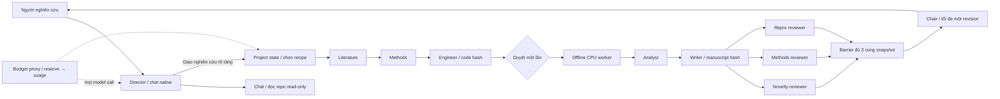

# AgentLabs V2: customize OpenClaw thành research lab

## Quyết định nền tảng

**OpenClaw native là nền chính.** AgentLabs là một distribution gồm profile, role contracts và extension nghiên cứu; không xây lại chat/session/subagent runtime bằng một ứng dụng thứ hai. AgentLaboratory cung cấp ý tưởng chu trình khoa học. Prototype V1 Python/LangGraph/React được giữ để tham khảo và tái sử dụng các module evidence/sandbox, không coi adapter OpenClaw của V1 là hoàn thành yêu cầu native.

Không tuyên bố đây là hệ thống tạo paper “tốt nhất” đã được chứng minh. Đây là phương án thiết kế phù hợp nhất với yêu cầu local, cập nhật upstream, nhiều reviewer và ngân sách nhỏ; chất lượng cần benchmark bằng bài toán thực.

## Đã clone và đọc những gì

| Repo local trên D | Pin đã đọc | Phần tham khảo | Quyết định |
| --- | --- | --- | --- |
| `openclaw` | `157d8c2b`, v2026.10.7 | Gateway/Control UI; native multi-agent; sessions_spawn/yield; tool policy; plugin/feature SDK và config schema | Reference/V1; đã tái hiện lỗi canonical-startup trên profile native |
| `openclaw-native` | `15dffe52`, v2026.10.10-beta.3 | Cùng public SDK, producer repair cho canonical-startup validation, profile migration | Native host pin hiện tại, prerelease riêng có lockfile; 10.7 đã tái hiện checkpoint failure sau restart |
| `reference-agent-laboratory` | `d9017d90` | `ai_lab_repo.py`, `agents.py`, `mlesolver.py`: literature, plan, code search/repair, interpretation, paper, review và quay lại thực nghiệm | Lấy scientific lifecycle; không chạy solver upstream trực tiếp trên host |
| `reference-openclaude` | `cb4a72bf` | README/LICENSE; package/CLI; `src/tools/AgentTool/runAgent.ts`: child context, model/tool routing, session persistence | Chỉ đọc tham khảo. LICENSE tự nêu có code dẫn xuất từ Claude Code proprietary; không đưa vào sản phẩm hoặc phân phối lại |

OpenClaw có Control UI Vite/Lit và chat streaming qua Gateway WebSocket, cùng agent roster và child-session views. Không cần dựng một giao diện React chat mới để có các khả năng nền này. Native plugin SDK có thể bổ sung trang, panel, composer và tool results; API này còn experimental, nên phải pin host và chạy contract tests khi nâng cấp.

Native hiện pin một **prerelease**, không gọi là bản stable. 2026.10.7 đã có lỗi checkpoint khiến bốn agent từ chối session sau restart; integrity check các database vẫn OK. Bản sửa canonical producer đã có trong beta đã chọn, xem [upstream #166634](https://github.com/openclaw/openclaw/issues/166634). Runtime được cài side-by-side, không sửa node_modules. State có backup trước migration schema bằng Doctor đúng phiên bản. CLI `status` kiểm tra từng agent; một Gateway đang listen chưa đủ nghiệm thu. Chưa soak-test dài hạn.

Nguồn: [OpenClaw architecture](https://docs.openclaw.ai/concepts/architecture), [native multi-agent](https://docs.openclaw.ai/concepts/multi-agent), [subagent contracts](https://docs.openclaw.ai/tools/subagents/tool-reference), [feature plugins](https://docs.openclaw.ai/plugins/feature-plugins), [AgentLaboratory workflow](https://github.com/SamuelSchmidgall/AgentLaboratory/blob/d9017d90e329112d2a80b7712f37ee9094d2cd27/ai_lab_repo.py), [OpenClaude NOTICE](https://github.com/Twigpine/openclaude/blob/cb4a72bf1c14cd754e545b985a38a53938dda656/LICENSE).

## Một chủ sở hữu cho mỗi trách nhiệm

Phần thiết kế dưới đây gồm cả đích dài hạn. Mục “Trạng thái thực tế” cuối tài liệu
phân biệt chức năng đã triển khai với worktree, dataset, PDF và research panels còn thiếu.

| Thành phần | Chủ sở hữu | Không làm lại ở nơi khác |
| --- | --- | --- |
| UI chat, transcript, streaming, sessions, native subagents, stop/recovery | OpenClaw | Không tạo thêm graph gọi LLM song song với native agent runtime |
| Ngữ nghĩa nghiên cứu, trạng thái project, snapshot, citation/evidence, review barrier | AgentLabs feature plugin + domain service | Không giao quyền xác nhận evidence/gate chỉ cho prompt của Director |
| Truy cập project/repo, Git snapshot/worktree, hạn mức tool | Project adapter | Không cấp shell toàn máy chỉ vì có workspace |
| Chạy code, dependencies, CPU/GPU/timeouts, approval theo hash | Experiment worker | Agent không tự sửa quyền và không tự duyệt mình |
| Call admission và chi phí theo tháng/project | Budget gate trên mọi model-call path | Không dùng token/time cap như một hard dollar cap |

Plugin dùng public `openclaw/plugin-sdk/*`, không import internals hoặc sửa `node_modules`. Tools hiện có schema riêng; UI composer dùng trực tiếp draft/session operations của host, chưa có research panel hoặc operation transport cho panel. Domain database access chạy trong worker/service, không blocking Gateway main loop. Giữ role/session identity từ host; model không tự điền role để nâng quyền.

## Bộ phận và agent native

Director cũng là front desk và PI, để chat thường không tốn thêm một tầng model.

| Agent ID | Trách nhiệm | Model tier mặc định |
| --- | --- | --- |
| director | Chat, hiểu mục tiêu, chọn quy trình và giao task bounded | Rẻ/free |
| literature | Paper discovery, đọc nguồn, evidence map và research gap chưa xác minh | Rẻ/free |
| methods | Giả thuyết, baseline, split, seed, metric, ablation, stopping rule | Mạnh |
| experiment | Sửa code trong worktree; tạo manifest và đề nghị chạy | Rẻ/free, escalation rõ khi debug khó |
| analysis | Audit raw logs/metrics, thống kê, failure analysis | Rẻ/free |
| writing | Manuscript/LaTeX, figures và bibliography từ evidence | Rẻ/free |
| review-novelty | Novelty, related work, nguồn và claim support | Rẻ/free |
| review-methods | Leakage, fairness, statistical validity, ablation | Rẻ/free |
| review-repro | Code/data/config/metrics lineage và tái lập | Rẻ/free |
| review-chair | Đối chiếu ba review với evidence, xử lý bất đồng, route tiếp | Mạnh |

Mỗi agent có workspace, agentDir và session store riêng do OpenClaw quản lý. Chỉ Director được spawn chín specialist từ allowlist; specialist là leaf, không tự sinh thêm người. Depth=1, concurrency tối đa 3. Task thường chạy tuần tự; ba review chạy song song, cùng snapshot và context isolated. Không fork toàn bộ chat cho mọi worker. Kết quả trả qua announce về parent; dùng `sessions_yield`, không polling liên tục.

## Chat và các quy trình theo nhiệm vụ

Sơ đồ thể hiện recipe đầy đủ; survey, experiment và paper chỉ đi qua các phase tương ứng. Gate/state thuộc plugin, không phụ thuộc việc agent tự tuyên bố “đã xong”.

1. **Chat:** giải thích code/kiến thức, trao đổi ý tưởng, chỉnh một đoạn văn → Director trả lời trực tiếp. Từ “research/paper” trong câu không tự kích hoạt team.
2. **Survey:** user giao khảo sát → scope → Literature → một review nguồn khi cần → evidence map. Không gọi Engineer/Writer/3 reviewer toàn phần một cách mặc định.
3. **Experiment:** Methods → Engineer → code/environment/dataset snapshot → human execution gate → worker → Analyst → Methods hoặc Reviewer kiểm tra. Chưa chạy thì trạng thái là missing evidence.
4. **Paper:** Writer nhận evidence pack đã có → freeze snapshot → R1/R2/R3 → barrier → Chair → sửa tối đa một vòng → human draft review. Không tự submission.
5. **Full lab:** scope → survey → protocol → experiment → analysis → paper/review. Chỉ dùng khi user giao đủ phạm vi và có ngân sách.

Luồng là artifact/task state machine có thể kiểm tra, không chỉ cho các nhân vật trò chuyện nối tiếp. Director chọn recipe; domain service quyết định một transition hợp lệ hay không.

## Hợp đồng task/evidence

Mỗi task có `project_id`, `task_id`, `parent_task_id`, `agent_id` từ host, `recipe`, `phase`, `input_artifact_ids`, `expected_output_schema`, `round`, `max_attempts`, `token_reservation`, `deadline`, `status` và `error`. Trạng thái tối thiểu: pending/running/waiting_human/succeeded/failed/cancelled. Task đã attempt nhưng chưa rõ kết quả không tự retry hay spawn bản trùng.

Mỗi artifact có content hash, producer task/session/run, Git commit hoặc dirty-tree snapshot, source/dataset/config hashes, timestamp và trạng thái draft/verified/superseded. Claim phải trỏ source span hoặc raw metric; DOI tồn tại không chứng minh claim đúng. PDF scan phải ghi không OCR nếu chưa OCR. Dữ liệu cũ không tự trở thành kết quả của vòng mới.

Reviewer phải trả scorecard schema có verdict, confidence, evidence_refs, blocking_issues, requested_checks và recommended_route. Domain service chỉ nhận ba review đúng role, round và cùng manuscript hash; Chair không được gọi để chốt nếu thiếu review. Đổi manuscript làm bộ review cũ không còn hợp lệ cho snapshot mới. Không dùng majority vote hoặc trung bình điểm làm bằng chứng khoa học.

## Đọc repo local như qnmln

Đăng ký đường dẫn user chỉ định theo project; chưa có đường dẫn qnmln thì không tự quét cả ổ đĩa. Resolve canonical path; kiểm tra junction/symlink; loại credentials, `.env`, caches, dữ liệu riêng chưa được chọn. Repo mặc định read-only.

Tools dự kiến: `project_tree`, `project_read_file` theo dòng, `project_search`, `project_git_status/diff`, `project_snapshot`. Citation code ghi path + commit/hash + dòng. Khi cần sửa, tạo Git worktree/task branch và patch preview; tránh đụng checkout đang nghiên cứu. Quyền đọc repo, sửa repo và chạy code là ba quyền riêng. Nội dung AGENTS/README trong repo nghiên cứu không tự được tăng quyền host hoặc mở truyền dữ liệu.

## Thực nghiệm và viết paper

Worker nhận manifest gồm argv có cấu trúc, environment/image digest, repo/data/config hash, seed/split, CPU/RAM/GPU, timeout, network policy và output contract. Không chạy raw shell từ một paragraph model viết. Approval gắn exact code/config/dataset snapshot, có hiệu lực một lần; sửa code yêu cầu approval mới. Chạy trong container/worktree, không mount provider keys. Cần network để tải dataset thì tách preparation có log và hạn mức.

Lưu stdout/stderr, exit code, raw metrics và machine/environment metadata. Process exit 0 chưa đủ: kiểm tra metric/schema, train/test leakage và baseline. Code repair tối đa 1–2 attempt trong budget, mỗi execution mới vẫn theo gate. GPU/SSH không tự thuê; connector chỉ triển khai khi user có compute phù hợp.

Writer không điền Results từ kỳ vọng. LaTeX/PDF cần compile + render check, citation registry và figures sinh từ raw data. Mỗi bản nháp giữ diff và unresolved issues. Scientific correctness vẫn cần nhà nghiên cứu đánh giá.

## Chi phí $10–20/tháng

Khởi đầu budget kế hoạch $15: $3 tác vụ thường có phí khi không dùng được free, $8 Methods/Chair/critical checks, $4 dự phòng. Đây là phân bổ, không phải số paper hoặc throughput được cam kết. Model rẻ/free phải hỗ trợ tool calling và được chọn theo quota thật; hết free quota thì pause, không đổi sang paid ngầm, không xoay tài khoản để vượt quota.

Profile native có Lean (Luna/Sol), Hybrid (model `:free` user cấu hình + Sol), Free (tất cả cùng free model). Không có fallback. Native đã có proxy loopback cho mọi model ref được cấu hình: transaction reserve trước request, settle reported usage sau response và giữ reservation khi kết quả không rõ. Mặc định $15/tháng, $1/ngày, 30 free requests/ngày, output 4k/call. Chỉ nhận text/function tools; từ chối hidden server history, hosted tools và background generation. Ledger V1 và native riêng. Đây là admission theo token/giá ước tính, chưa phải hard cap hóa đơn tài khoản; đặt thêm spending limit upstream.

## UI

Dùng Control UI gốc của OpenClaw làm điểm vào. Màn hình thường chỉ chat với Director. Composer có Chat / Nghiên cứu, bốn gợi ý AI/ML và + Chat mới qua native sessions API; giữ built-in composer để không làm lại attachments, send/stop và draft ownership. Nút đổi chế độ chỉ sửa nháp. Tài liệu đích: artifacts, experiment approval, review board và budget ở panel/trang riêng; panel chưa triển khai. Không đưa mười dashboard và log lên màn hình chat. Theme sáng và sidebar thu gọn; custom browser code qua public Control UI contract được profile bật rõ.

## Trạng thái thực tế và tiêu chí nghiệm thu

**Đã triển khai:** profile riêng trên D, Control UI và 10 native agents; role/phase spawn gate; depth/concurrency limits; plugin state SQLite qua worker/CAS với invocation guard; role/round assignment tokens; artifacts có SHA256; Crossref metadata; ba review cùng snapshot, sealed peer reports và Chair barrier; tối đa một revision; native approval một lần theo code hash; offline Docker worker; read-only repo allowlist/source tools; budget/usage proxy; launcher và tests. Source OpenClaw giữ nguyên, runtime official cùng pin. UI theme sáng, sidebar thu gọn, AI/ML welcome và Chat / Nghiên cứu / Chat mới qua native UI contract.

**Chưa triển khai/xác minh:** repo mutation/worktree, PDF full text/page spans, dataset snapshots/mounts, native research panels/export và LaTeX/PDF. Worker hiện chỉ import logs, execution metadata và metrics.json cho smoke experiment CPU. Đã test logic/state và nạp plugin vào host; chưa chạy model thật, native spawn/approval/review end-to-end hoặc Docker với dữ liệu nghiên cứu vì chưa có API key và Docker engine đang tắt. Tool gates không chứng minh claim support, novelty hay thống kê đúng.

Thứ tự build tiếp theo và điều kiện hoàn thành:

1. Hoàn tất pilot native: typed operations/state/artifacts và budget admission đã có; cần model thật xác minh spawn, approval, streaming tools và cost reconciliation.
2. Repo adapter + experiment worker: một repo pilot user chọn, baseline tái lập, approval/hash mismatch bị chặn, restart không chạy lại side effect.
3. Review + paper UI: ba isolated reviewer cùng snapshot, lỗi/thiếu reviewer giữ HOLD, manuscript revision và source spans kiểm tra được.
4. Pilot 10–20 tasks có lỗi cài sẵn: đo citation/claim support, leakage/metric-bug detection, reproducibility, false positives, cost và latency; so với single agent và AgentLaboratory trên cùng task.

Chỉ khi các điều kiện này qua mới gọi V2 là harness nghiên cứu hoàn chỉnh. Không lấy agent roster, UI mở được hoặc điểm LLM tự chấm làm bằng chứng hoàn thành nghiên cứu.
